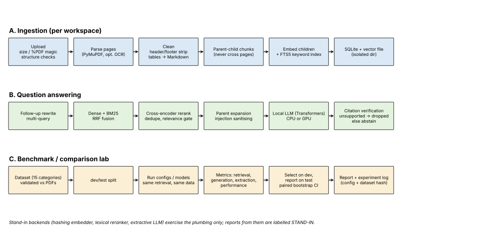

# LocalPDF Intelligence

Fully local PDF question answering (hybrid retrieval, reranking, verified citations, abstention) plus a benchmarking
and model-comparison engine. No cloud inference; nothing leaves the machine.

## Status: read this first
| Part | State |
|---|---|
| Chunking, store, retrieval, RAG logic, citation verification, security, workspaces | implemented, 79 tests passing |
| Benchmark engine (schema, validation, metrics, sweep, bootstrap CIs, reports) | implemented and tested |
| Synthetic dataset (32 items, 14 of 15 categories; OCR not covered) and 3 PDFs | generated; evidence verified against the PDFs with `pdftotext` |
| `parsing/pdf.py` (PyMuPDF), `backends/hf.py` (Transformers), `api.py` (FastAPI) | run end to end with real local models on CPU |
| OCR for scanned PDFs (RapidOCR, offline) | implemented; on image-only test PDFs ~0-2% character error on prose, ~20% on pipe-drawn tables |
| React web UI (`frontend/`, served at `/`) | implemented: upload, document scoping, streaming answers, citation chips, real page-image preview |
| LLM-judged verification | implemented: optional per-answer double-check in the pipeline/UI, and `--judge` metrics in the benchmark |
| Real model benchmark numbers | `reports/sweep_cpu_fast/` (Qwen2.5-0.5B, CPU). `reports/smoke_stand_in/` is a stand-in pipeline check, not model results |
| Screenshots, demo video, FAISS, Docling/Camelot | not implemented |

Model IDs in `config.py` are untested defaults. Nothing here claims one model or configuration is better than another;
the report only says so when a paired bootstrap interval excludes zero on the held-out test split.

## Install
    pip install -r requirements.txt        # or: pip install -e ".[pdf,models,api,dev]"
    python -m pytest                       # 66+ tests; API/PDF tests skip if their packages are missing

## Run the app
    python -m localpdf.serve                       # real local models, hardware profile picked automatically
    python -m localpdf.serve --profile cpu-fast    # smallest models (CPU, ~2.5 GB RAM)
    # then open http://127.0.0.1:8000

The React UI is prebuilt into `localpdf/web/`. To change it: `cd frontend && npm install && npm run build`
(or `npm run dev` for hot reload against a running backend).

## Use
    python -m localpdf.bench.cli smoke                         # no models needed; labelled STAND-IN
    python -m localpdf.bench.cli validate --dataset my.jsonl --pdf-dir my_pdfs/
    python -m localpdf.bench.cli sweep --backend hf --out reports/sweep_hw1
    python -m localpdf.bench.cli sweep --backend hf --judge-llm Qwen/Qwen2.5-1.5B-Instruct   # + LLM-judged metrics
    python -m localpdf.bench.cli compare-models --models models.json --out reports/models_hw1
    uvicorn localpdf.api:create_app --factory              # stand-in backends by default; pass real ones in code

`models.json`: `[{"name":"qwen-1.5b","llm_id":"Qwen/Qwen2.5-1.5B-Instruct","quantization":"none"}, ...]`

Dataset format (JSONL): question, expected answer, supporting PDF, ground-truth page, evidence, category, difficulty
(see `localpdf/bench/schema.py`). Your own datasets are checked against your PDFs; mismatched evidence is rejected.

## Hardware (profiles chosen automatically, override with `--profile`)
| Profile | Intended hardware |
|---|---|
| gpu / gpu-4bit-7b | CUDA GPU (more VRAM for the larger model; 4-bit needs bitsandbytes) |
| cpu-quality / cpu-balanced / cpu-fast | CPU only; trade answer quality for speed and RAM |
CPU runs work but are slow with larger LLMs. Exact RAM/VRAM and latency figures must come from a real run on your
hardware (the report records peak RAM/VRAM and tokens/s).

