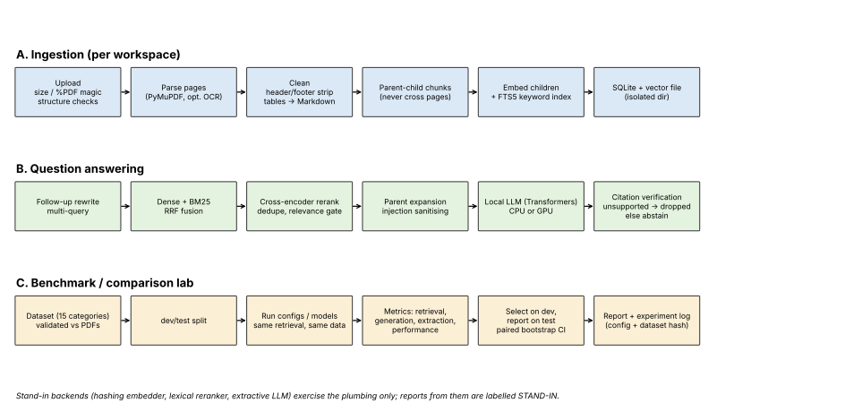

# Architecture

Regenerate the graph with `python scripts/make_workflow_graph.py`.

## Modules
| Module | Responsibility |
|---|---|
| `localpdf/security.py` | upload validation, filename/collection/workspace-id sanitising, prompt-injection guard |
| `localpdf/parsing/` | PDF text extraction (PyMuPDF, optional OCR), cleaning, parent/child chunking |
| `localpdf/store.py` | SQLite (documents, pages, chunks, FTS5) + numpy vector index, metadata filters, deletion/purge |
| `localpdf/retrieval.py` | dense + BM25 retrieval, RRF fusion, rerank, dedupe, balanced multi-document retrieval |
| `localpdf/rag.py` | pipeline, citation verification, abstention, modes, confidence |
| `localpdf/backends/` | embedder / reranker / LLM protocols; `hf` (Transformers, CPU/GPU) and `fake` (stand-in, plumbing only) |
| `localpdf/workspace.py` | per-user isolated workspaces (own DB, index, originals) |
| `localpdf/api.py` | FastAPI service |
| `localpdf/bench/` | dataset schema + validation, metrics, resource monitor, runner, sweep, report, CLI |

## Design rules
* Every stage is a plain function/class with its own tests; backends are injected, so stages run without models.
* Answers are verified in code: sentences not supported by retrieved text are removed; if nothing remains the system abstains.
* Benchmarks refuse ground truth that is not present on the stated PDF page. Configurations are chosen on the dev split and reported on the held-out test split. A winner is declared only if the paired bootstrap interval excludes 0; otherwise the report says "tie".
* Stand-in backends set `is_stand_in`, and every report derived from them carries a STAND-IN banner.
