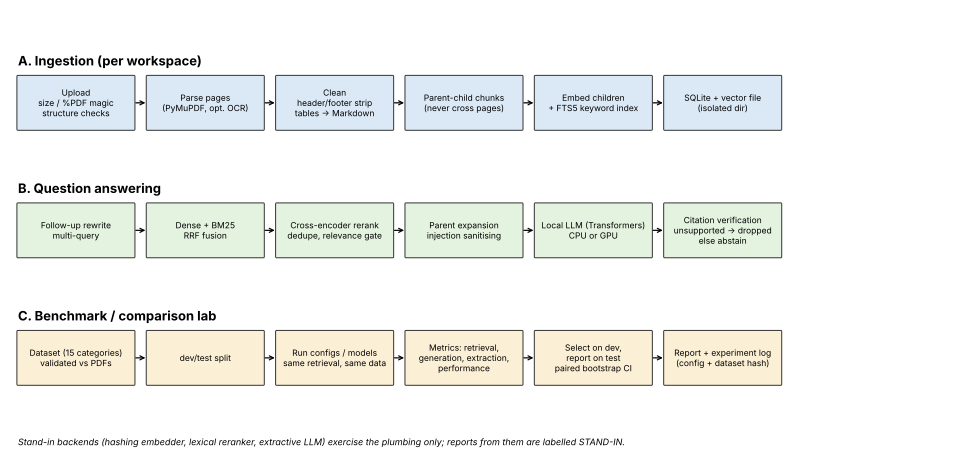

# LocalPDF Intelligence

Fully local PDF question answering (hybrid retrieval, reranking, verified citations, abstention) plus a benchmarking
and model-comparison engine. No cloud inference; nothing leaves the machine.

## Status: read this first
| Part | State |
|---|---|
| Chunking, store, retrieval, RAG logic, citation verification, security, workspaces | implemented, 66 unit tests passing (with stand-in backends) |
| Benchmark engine (schema, validation, metrics, sweep, bootstrap CIs, reports) | implemented and tested |
| Synthetic dataset (32 items, 14 of 15 categories; OCR not covered) and 3 PDFs | generated; evidence verified against the PDFs with `pdftotext` |
| `parsing/pdf.py` (PyMuPDF), `backends/hf.py` (Transformers), `api.py` (FastAPI) | **written but never run** - the build sandbox had no PyMuPDF, torch or FastAPI |
| Real model benchmark numbers | **none exist yet.** `reports/smoke_stand_in/` is a pipeline check using stand-in backends, not model results |
| React UI, screenshots, demo video, FAISS, Docling/PaddleOCR/Camelot | not implemented |

Model IDs in `config.py` are untested defaults. Nothing here claims one model or configuration is better than another;
the report only says so when a paired bootstrap interval excludes zero on the held-out test split.

## Install
    pip install -r requirements.txt        # or: pip install -e ".[pdf,models,api,dev]"
    python -m pytest                       # 66+ tests; API/PDF tests skip if their packages are missing

## Use
    python -m localpdf.bench.cli smoke                         # no models needed; labelled STAND-IN
    python -m localpdf.bench.cli validate --dataset my.jsonl --pdf-dir my_pdfs/
    python -m localpdf.bench.cli sweep --backend hf --out reports/sweep_hw1
    python -m localpdf.bench.cli compare-models --models models.json --out reports/models_hw1
    uvicorn localpdf.api:create_app --factory              # stand-in backends by default; pass real ones in code

`models.json`: `[{"name":"qwen-1.5b","llm_id":"Qwen/Qwen2.5-1.5B-Instruct","quantization":"none"}, ...]`

Dataset format (JSONL): question, expected answer, supporting PDF, ground-truth page, evidence, category, difficulty
(see `localpdf/bench/schema.py`). Your own datasets are checked against your PDFs; mismatched evidence is rejected.

## Hardware (profiles chosen automatically, override with `--profile`)
| Profile | Intended hardware |
|---|---|
| gpu / gpu-4bit-7b | CUDA GPU (more VRAM for the larger model; 4-bit needs bitsandbytes) |
| cpu-quality / cpu-balanced / cpu-fast | CPU only; trade answer quality for speed and RAM |
CPU runs work but are slow with larger LLMs. Exact RAM/VRAM and latency figures must come from a real run on your
hardware (the report records peak RAM/VRAM and tokens/s).

## Known limitations
* Lexical faithfulness / semantic-similarity metrics are proxies, not LLM-judged scores.
* Citation verification is lexical (sentence-level support), so it can drop correct but heavily paraphrased sentences.
* The synthetic corpus is small and templated; results on it say little about real documents. Bring real PDFs and a dataset.
* OCR, scanned-page and ruled-table handling are untested here.
* A 32-item dataset gives wide confidence intervals; most comparisons will honestly come out as ties.
